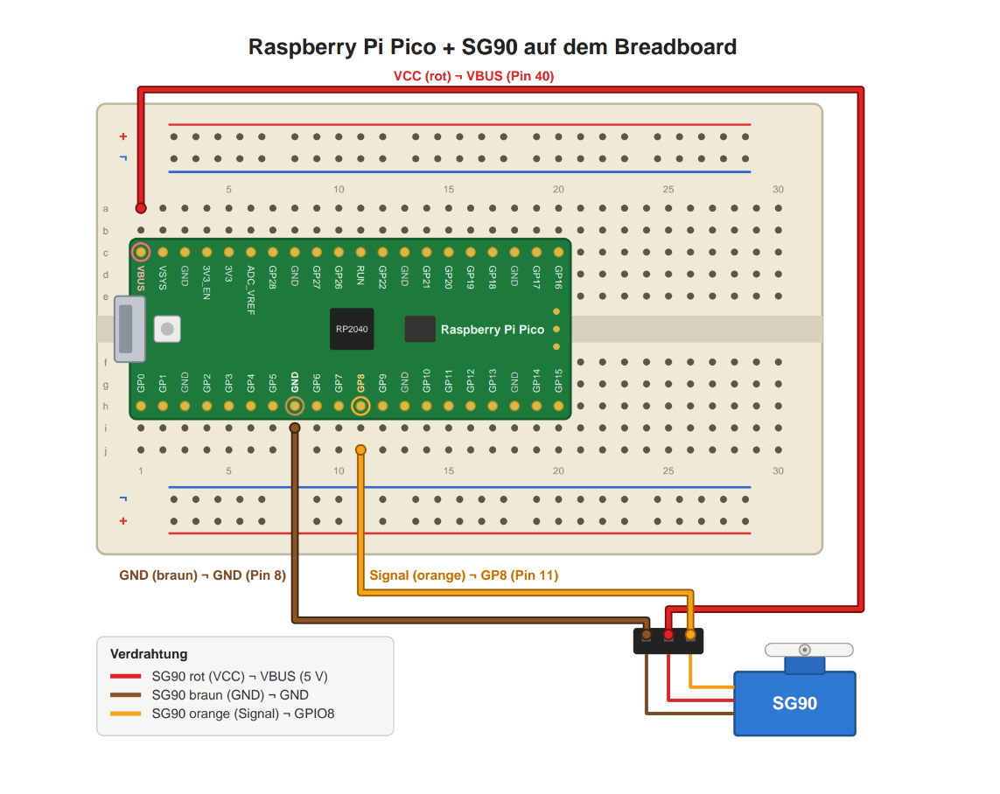

# Parkhaus mit Schranke

Ein Parkhaus mit automatischer Schranke, Gebührenberechnung und Kasse, umgesetzt auf zwei
Raspberry Pi Pico W. Autos werden bei der Einfahrt erfasst, bezahlen an einer virtuellen
Kasse und dürfen nur nach erfolgter Bezahlung wieder hinaus.

Modul M450, Auftrag A01-03. Geschrieben in C++ mit dem Arduino-Framework, gebaut mit PlatformIO.

## Wichtige Info

Ich habe meine gesamte Codebasis von einer KI überarbeiten und kommentieren lassen, um sie an die Best Practices von C++ anzupassen und besser verständlich zu machen, da ich zuvor noch nie in C++ programmiert hatte und mein Code unübersichtlich war. Ausserdem habe ich die KI beauftragt, diese README-Datei und die Projektdokumentation zu schreiben.

## Weiterführende Dokumentation

[`docs/Projekt-Erklaerung.md`](docs/Projekt-Erklaerung.md) erklärt das ganze Projekt für
Leserinnen und Leser ohne C++-Kenntnisse: worum es geht, wie die Geräte miteinander reden,
jede Quelldatei Schritt für Schritt und zum Schluss eine komplette Fahrt eines Autos durch
alle Funktionen.

[`ProjektSetup.md`](ProjektSetup.md) erläutert, wie das Projekt einzurichten und zu ausführen ist.

## Inhalt

- [Gruppenmitglieder](#gruppenmitglieder)
- [Kurzbeschreibung](#kurzbeschreibung)
- [Umgesetzte User Stories](#umgesetzte-user-stories)
- [Hardware und Verkabelung](#hardware-und-verkabelung)
- [Inbetriebnahme](#inbetriebnahme)
- [Bedienung](#bedienung)
- [Tarif und Regeln](#tarif-und-regeln)
- [Aufbau der Software](#aufbau-der-software)
- [HTTP-Schnittstelle](#http-schnittstelle)
- [Unterstützung für die Tests](#unterstützung-für-die-tests)
- [Fehlerbehebung](#fehlerbehebung)
- [Bekannte Einschränkungen](#bekannte-einschränkungen)
- [Weiterführende Dokumentation](#weiterführende-dokumentation)

---

## Gruppenmitglieder

| Name | Rolle |
| --- | --- |
| Adam Mehila | Einzelarbeit: Anforderungen, Umsetzung, Test |

---

## Kurzbeschreibung

Das System besteht aus zwei Picos mit klar getrennten Aufgaben. Beide sind im selben WLAN
und reden per HTTP miteinander. Jeder stellt eine eigene Weboberfläche bereit, die im
Browser eines Laptops geöffnet wird.

| | Pico 1: Kasse | Pico 2: Schranke |
| --- | --- | --- |
| Aufgabe | speichert alle Parkvorgänge, berechnet Gebühren, nimmt Bezahlungen an | erfasst Ein- und Ausfahrt, steuert den Servo |
| Weboberfläche | Kennzeichen suchen, Gebühr anzeigen, bezahlen, Fahrzeugliste | je ein Eingabefeld für Einfahrt und Ausfahrt |
| Hardware | nur USB-Kabel | USB-Kabel und SG90-Servo, Signal an GP8 (Pin 11) |
| Adresse | `http://<IP-KASSE>` | `http://<IP-SCHRANKE>` |

```text
   Browser: Seite der Kasse                       Browser: Seite der Schranke
            │                                                │
            v                                                v
   ┌──────────────────┐   Einfahrt melden, Status   ┌──────────────────┐   PWM   ┌───────┐
   │  Pico 1: Kasse   │ <────────────────────────── │ Pico 2: Schranke │ ──────> │ Servo │
   │  einzige Stelle, │   abfragen, Ausfahrt melden │  speichert nichts│         └───────┘
   │  die Daten hält  │                             │  selbst          │
   └──────────────────┘                             └──────────────────┘
```

Es gibt keine Kamera. Das Eintippen des Kennzeichens auf der Seite der Schranke ersetzt die
Kennzeichenerkennung.

**Ablauf einer Einfahrt:** Kennzeichen eintippen. Pico 2 prüft das Format und meldet die
Einfahrt der Kasse. Die Kasse prüft, ob noch ein Platz frei ist und das Auto nicht schon
drinsteht, und speichert Kennzeichen und Einfahrtszeit. Erst dann öffnet sich der Schrankenarm
und schliesst nach 5 Sekunden von selbst.

**Ablauf einer Ausfahrt:** An der Kasse das Kennzeichen suchen, die Gebühr wird angezeigt,
bezahlen. Dann an der Schranke das Kennzeichen ins Ausfahrtsfeld tippen. Pico 2 fragt die
Kasse nach dem Bezahlstatus. Nur bei „bezahlt" wird der Vorgang abgeschlossen und die
Schranke geöffnet. Sonst erscheint ein Hinweis mit dem offenen Betrag, und die Schranke
bleibt zu.

---

## Umgesetzte User Stories

| # | User Story / Anforderung | Umsetzung | Testfälle |
| --- | --- | --- | --- |
| 1 | Kennzeichen bei der Einfahrt erfassen, inklusive Zeitstempel | `registerEntry()` speichert Kennzeichen und Einfahrtszeit. Anzeige in der Fahrzeugliste der Kasse. | T01, T02, T03, T24 |
| 2 | Einfahrtsschranke öffnet automatisch und schliesst nach 5 Sekunden selbständig | `Barrier::open()` und `Barrier::update()`, ohne `delay()`, die Weboberfläche bleibt währenddessen bedienbar | T04, T05 |
| 3 | Ungültige Kennzeichen werden bei der Einfahrt abgelehnt | `checkPlate()` auf beiden Picos: leer, zu lang, falsches Format. Der Servo bewegt sich nicht, die Kasse bekommt keinen Eintrag. | T06, T07, T08 |
| 4 | Einfahrt bei vollem Parkhaus ablehnen, Kapazität verwalten | `countOccupiedSpots()` gegen `MAX_PARKING_SPOTS` (3 Plätze). Belegung auf beiden Oberflächen sichtbar. | T09, T10, T11 |
| 5 | Parkgebühr aus der Parkdauer nach Tarif berechnen | `calculateFeeInCents()`: CHF 2.00 pro angefangene Stunde | T12, T13, T14, T15 |
| 6 | Bezahlung an der virtuellen Kasse | `payParkingFee()`. Doppelte Bezahlung wird verhindert, unbekannte Kennzeichen können nicht bezahlt werden. | T16, T17, T18 |
| 7 | Ausfahrtsschranke öffnet nur nach erfolgter Bezahlung | Pico 2 fragt vor jeder Ausfahrt `/api/status` ab und öffnet nur bei `paid` | T19 |
| 8 | Klarer Hinweis, wenn ohne Bezahlung ausgefahren werden soll | Meldung mit dem offenen Betrag, die Schranke bleibt zu | T20 |
| Z1 | Grenzfall: unter `BE 55511` bezahlt, an der Ausfahrt wird `BE 55512` eingegeben | Meldung „keine Einfahrt bekannt", Schranke bleibt zu. Mit dem richtigen Kennzeichen öffnet sie. | T21 |
| Z2 | Zusammenspiel beider Picos über den gesamten Ablauf | HTTP-Schnittstelle zwischen Pico 2 und Pico 1 | T22, T24 |
| Z3 | Robustes Verhalten bei einem Netzwerkausfall | Timeout von 2 Sekunden, Hinweis „Kasse nicht erreichbar", Schranke bleibt zu, WLAN verbindet sich von selbst neu | T23 |

---

## Hardware und Verkabelung

### Teileliste

| Anzahl | Teil |
| --- | --- |
| 2 | Raspberry Pi Pico W mit aufgelöteten Stiftleisten |
| 1 | SG90-Servo mit Schrankenarm |
| 1 | Steckbrett und drei Jumper-Kabel (Stecker auf Stecker) |
| 2 | Micro-USB-Kabel für Strom und zum Flashen |
| 1 | Laptop mit Browser, im selben Netz wie die Picos |

### Servo an Pico 2

Der Servo kommt an **Pico 2**. Pico 1 braucht nur das USB-Kabel.



| Servo-Ader | Pin am Pico | Bezeichnung | Loch im Steckbrett |
| --- | --- | --- | --- |
| rot | Pin 40 | VBUS, 5 V vom USB-Kabel | **J1** |
| braun | Pin 8 | GND, Masse | **A8** |
| orange | Pin 11 | **GP8**, Steuersignal | **A11** |

Die Löcher gelten für den Aufbau, wie er bei uns auf dem Tisch steht: Steckbrett **hochkant**,
die Reihen 1 bis 30 von oben nach unten, der Pico mit der **USB-Buchse nach oben**. Seine linken
Beinchen (Pin 1 bis 20) stecken in Spalte **C**, seine rechten (Pin 40 bis 21) in Spalte **H**,
das oberste Beinchen in Reihe 1. Damit liegen alle GP-Pins und Pin 8 (GND) auf der **linken**
Hälfte (A bis E) und VBUS auf der **rechten** (F bis J).

In jeder Reihe sind die Löcher A bis E miteinander verbunden, und getrennt davon F bis J. Ein
Kabel ist also mit einem Pin verbunden, wenn es in **derselben Reihe** und auf **derselben
Hälfte** steckt wie dieser Pin.

**Achtung beim Bild:** Im Bild liegt das Steckbrett **quer**, mit der USB-Buchse links. Seine
Buchstaben und Zahlen passen deshalb nicht zu einem hochkant liegenden Steckbrett. Richte dich
nach den Pin-Namen im Bild (VBUS, GND, GP8), nicht nach den Lochangaben darin.

Im Code steht der Signal-Pin an genau einer Stelle: `SERVO_PIN_ENTRY` in
[`src/common/config.h`](src/common/config.h), zurzeit `8` für GP8. Steckt das orange Kabel
an einem anderen Pin, muss dort dessen **GPIO-Nummer** stehen (nicht die Pin-Nummer). Die
Webseite und alle Meldungen übernehmen den Wert von dort.

Bei unserem Aufbau steht der Arm geschlossen auf 90 Grad und offen auf 0 Grad, die
Offenhaltezeit beträgt 5 Sekunden. Das hängt davon ab, wie der Arm auf die Achse des Servos
gesteckt ist. Fährt die Schranke falsch herum, tauscht man `SERVO_ANGLE_CLOSED` und
`SERVO_ANGLE_OPEN` in `config.h`.

### Ein oder zwei Servos

Die Firmware ist auf **einen** Servo eingestellt (`SERVO_COUNT 1` in
`src/common/config.h`). Einfahrt und Ausfahrt teilen sich dann denselben Arm. Fachlich
bleiben beide Vorgänge getrennt und prüfen ihre eigenen Bedingungen, nur der Antrieb ist
derselbe.

Für zwei Servos genügt es, `SERVO_COUNT` auf `2` zu setzen und das Signal des zweiten
Servos an GP9 (Pin 12) anzuschliessen. Strom und Masse kommen von denselben Pins wie beim
ersten.

---

## Inbetriebnahme

### 1. Werkzeuge installieren

- [Visual Studio Code](https://code.visualstudio.com/)
- darin die Erweiterung **PlatformIO IDE**

Beim ersten Bauen lädt PlatformIO die Toolchain für den Pico selbst herunter. Das dauert
einige Minuten.

### 2. WLAN und Adressen einstellen

Alles steht in [`src/common/config.h`](src/common/config.h):

| Einstellung | Bedeutung |
| --- | --- |
| `WIFI_SSID`, `WIFI_PASSWORD` | Name und Passwort des WLANs |
| `IP_CASHDESK`, `IP_BARRIERS` | feste Adressen der beiden Picos |
| `IP_GATEWAY` | Adresse des Routers |
| `IP_SUBNET_MASK` | Subnetzmaske des Netzes |

**Wichtig: Der Pico W kann nur 2,4 GHz.** Viele Router geben dem 2,4-GHz-Netz einen eigenen
Namen, etwa mit dem Zusatz `-2.4GHz`. Genau diesen Namen eintragen.

Gateway und Subnetzmaske findet man am Laptop, der im selben Netz hängt, mit `ipconfig`
(Windows). Die beiden Pico-Adressen müssen im selben Bereich liegen und frei sein. Ein
`ping` auf die Adresse sollte vorher keine Antwort bekommen.

Das Testkonzept sieht ein eigenes Testnetz `PARK-TEST-NET` im Bereich `192.168.4.x` vor. Für
dieses Netz müssen die Werte entsprechend angepasst werden.

### 3. Firmware bauen

Aus einem Projekt entstehen zwei Firmwares, eine pro Pico:

```text
pio run -e pico1_cashdesk     Firmware der Kasse
pio run -e pico2_barriers     Firmware der Schranke
pio run                       beide
```

In VS Code geht das auch über das PlatformIO-Symbol in der linken Leiste. Das Ergebnis liegt
in `.pio/build/<Umgebung>/firmware.uf2`.

### 4. Auf die Picos übertragen

Die beiden Picos am besten mit „1 Kasse" und „2 Schranke" beschriften. Der Pico mit dem
Servo bekommt die Schranken-Firmware.

**Weg A, direkt aus PlatformIO:**

```text
pio run -e pico1_cashdesk -t upload
pio run -e pico2_barriers -t upload
```

**Weg B, per Dateikopie** (funktioniert immer, auch wenn Weg A mit
`Please specify upload_port` abbricht):

1. Den weissen Knopf **BOOTSEL** auf dem Pico gedrückt halten und dabei das USB-Kabel
   einstecken. Der Pico erscheint als Laufwerk `RPI-RP2`.
2. Die passende `firmware.uf2` auf dieses Laufwerk kopieren.
3. Der Pico übernimmt sie, startet neu, und das Laufwerk verschwindet.

Danach den Pico **ohne** gedrückten Knopf betreiben. Mit gedrücktem Knopf startet er
immer im Flash-Modus statt mit dem Programm.

### 5. Prüfen, ob alles läuft

- Die kleine **LED** auf jedem Pico leuchtet, sobald er im WLAN ist.
- Im seriellen Monitor (`pio device monitor`, 115200 Baud) meldet jeder Pico beim Start,
  welche WLANs er sieht, ob die Verbindung geklappt hat und unter welcher Adresse er
  erreichbar ist. Klappt es nicht, steht dort der Grund im Klartext.
- Auf der Seite der Schranke unten auf **„Servo testen"** klicken. Der Arm muss sich öffnen
  und nach 5 Sekunden wieder schliessen.

---

## Bedienung

1. **Kasse** im Browser öffnen (`http://<IP-KASSE>`, der Wert von `IP_CASHDESK`). Dabei stellt der Browser einmalig
   die Uhr des Pico, denn der Pico hat keine eigene Uhr mit Batterie.
2. **Schranke** in einem zweiten Tab öffnen (`http://<IP-SCHRANKE>`, der Wert von `IP_BARRIERS`).
3. **Einfahrt:** Kennzeichen wie `LU 12345` eintippen, „Einfahrt bestätigen". Die Schranke
   öffnet sich, das Auto erscheint in der Fahrzeugliste der Kasse.
4. **Bezahlen:** An der Kasse das Kennzeichen suchen. Einfahrt, Parkdauer und Gebühr werden
   angezeigt. „Bezahlen" drücken.
5. **Ausfahrt:** An der Schranke das Kennzeichen ins Ausfahrtsfeld tippen, „Ausfahrt
   bestätigen". Die Schranke öffnet sich, das Auto wandert an der Kasse in die Liste der
   abgeschlossenen Vorgänge.

---

## Tarif und Regeln

| Regel | Wert |
| --- | --- |
| Tarif | CHF 2.00 pro angefangene Stunde |
| Gratiszeit | keine |
| Tagesmaximum | keines |
| Kapazität | 3 Plätze |
| Offenhaltezeit der Schranke | 5 Sekunden |
| Gültiges Kennzeichen | zwei Buchstaben, Leerzeichen, ein bis sechs Ziffern, z. B. `LU 12345` |
| Höchstlänge | 10 Zeichen |

| Parkdauer | Gebühr |
| --- | --- |
| 1 Minute | CHF 2.00 |
| genau 60 Minuten | CHF 2.00 |
| 61 Minuten | CHF 4.00 |
| 2 Stunden 1 Minute | CHF 6.00 |

Weitere Regeln:

- Kleinschreibung und ein fehlendes Leerzeichen werden korrigiert: `lu12345` wird zu
  `LU 12345`.
- Nach der Bezahlung ist der Betrag eingefroren. Bleibt das Auto noch etwas stehen, wird
  keine neue Schuld angezeigt.
- Ein zweites Bezahlen wird nicht ausgeführt, die Kasse meldet „bereits bezahlt".
- Ein Auto, das schon im Parkhaus steht, kann nicht ein zweites Mal einfahren.

---

## Aufbau der Software

```text
platformio.ini                 zwei Build-Umgebungen, eine pro Pico
src/
  common/                      in beiden Firmwares
    config.h                   alle Einstellungen: WLAN, Adressen, Tarif, Pins, Zeiten
    license_plate.h/.cpp       Kennzeichen prüfen und vereinheitlichen
    clock_time.h/.cpp          Laufzeituhr, Datum, Dauer und Beträge als Text
    json_text.h                Text sicher in JSON-Antworten einsetzen
    network.h/.cpp             WLAN-Verbindung, Wiederverbinden, Diagnose
  cashdesk/                    nur Pico 1, die Kasse
    parking_garage.h/.cpp      Parkvorgänge, Kapazität, Gebühr, Bezahlung
    web_page_cashdesk.h        Weboberfläche der Kasse
    main.cpp                   Webserver und Endpunkte der Kasse
  barriers/                    nur Pico 2, die Schranke
    barrier.h/.cpp             Servo öffnen und von selbst schliessen
    cashdesk_client.h/.cpp     Anfragen an die Kasse
    web_page_barriers.h        Weboberfläche der Schranke
    main.cpp                   Webserver, Einfahrts- und Ausfahrtslogik
  servo_test/                  eigenes Prüfprogramm, nur der Servo
    main.cpp                   fährt den Arm jede Sekunde hin und her
docs/
  Projekt-Erklaerung.md        ausführliche Erklärung von Projekt, Kommunikation und Code
  verkabelung.png              Schaltbild: Pico und Servo auf dem Steckbrett
```

Welche Ordner in welche Firmware kommen, regelt `build_src_filter` in `platformio.ini`.

Die wichtigsten Entwurfsentscheidungen:

- **Eine einzige Quelle der Wahrheit.** Nur die Kasse speichert Parkvorgänge. Die Schranke
  fragt bei jeder Entscheidung nach und hält selbst keine Daten.
- **Nichts blockiert.** Die Schranke schliesst über einen Zeitvergleich mit `millis()` statt
  mit `delay()`. Die Weboberflächen bleiben jederzeit bedienbar.
- **Im Zweifel bleibt die Schranke zu.** Antwortet die Kasse nicht, öffnet sich nichts. Bei
  der Ausfahrt wird der Vorgang zuerst an der Kasse abgeschlossen und erst danach die
  Schranke geöffnet, damit ein Fehler nie einen Platz dauerhaft blockiert.
- **Gestaffelte Prüfung.** Kennzeichen werden auf beiden Picos geprüft. Die Kasse verlässt
  sich nicht darauf, dass Pico 2 schon geprüft hat.
- **Geld als ganze Zahl.** Beträge werden in Rappen gerechnet, nie mit Kommazahlen.

---

## HTTP-Schnittstelle

Alle Endpunkte werden mit `GET` aufgerufen, nehmen ihre Parameter in der Adresse entgegen
und antworten mit JSON. Man kann sie auch direkt im Browser aufrufen.

### Pico 1, Kasse

| Endpunkt | Aufgerufen von | Bedeutung |
| --- | --- | --- |
| `/` | Browser | Weboberfläche der Kasse |
| `/api/vehicles` | Browser, Pico 2 | Belegung, Fahrzeuge im Parkhaus, abgeschlossene Vorgänge |
| `/api/status?plate=LU%2012345` | Browser, Pico 2 | Auskunft zu einem Kennzeichen, Status `unknown`, `unpaid` oder `paid` |
| `/api/entry?plate=...` | Pico 2 | Einfahrt registrieren |
| `/api/pay?plate=...` | Browser | Gebühr bezahlen |
| `/api/exit?plate=...` | Pico 2 | Parkvorgang abschliessen, Platz freigeben |
| `/api/setclock?epoch=...` | Browser | Uhr aus der Zeit des Browsers stellen (nur beim ersten Mal) |
| `/api/debug/time?plate=...&minutes=61` | Browser | nur Test-Build: Einfahrtszeit zurückdatieren |
| `/api/debug/reset` | Browser | nur Test-Build: alle Parkvorgänge löschen |

### Pico 2, Schranke

| Endpunkt | Aufgerufen von | Bedeutung |
| --- | --- | --- |
| `/` | Browser | Weboberfläche der Schranke |
| `/api/entry?plate=...` | Browser | Einfahrt durchführen |
| `/api/exit?plate=...` | Browser | Ausfahrt durchführen |
| `/api/state` | Browser | Belegung, Erreichbarkeit der Kasse, Zustand des Arms |
| `/api/servotest` | Browser | nur Test-Build: Servo einmal auf und zu |

### Beispielantworten

```text
GET /api/status?plate=LU%2012345            (Kasse)
{"plate":"LU 12345","status":"unpaid","entry":"22.10.2026 23:02:56",
 "duration":"0 h 00 min","fee":"CHF 2.00","feeInCents":200}

GET /api/exit?plate=LU%2012345              (Schranke, noch nicht bezahlt)
{"ok":false,"message":"Die Parkgebühr für LU 12345 ist noch offen (CHF 2.00).
 Bitte zuerst an der Kasse bezahlen. Die Schranke bleibt geschlossen."}
```

---

## Unterstützung für die Tests

Das Testkonzept verlangt Hilfsmittel, die nur im **Test-Build** vorhanden sind. Gesteuert
wird das über `-DTEST_BUILD=1` in `platformio.ini`.

- **Zeitmanipulation:** `/api/debug/time` verschiebt die Einfahrtszeit eines Fahrzeugs um
  beliebig viele Minuten in die Vergangenheit. Damit lassen sich die Tarifgrenzen bei 60 und
  61 Minuten in Sekunden statt in Stunden prüfen. Auf der Kassenseite gibt es dafür ein Feld.
- **Alles löschen:** `/api/debug/reset` setzt die Kasse für den nächsten Testfall zurück.
- **Servo-Test:** `/api/servotest` bewegt die Schranke ohne Parkvorgang. Damit wird vor dem
  ersten Testfall geprüft, ob die Verkabelung stimmt.

Für den Produktivbetrieb wird `TEST_BUILD` auf `0` gesetzt. Die Endpunkte und die
Testwerkzeuge in den Weboberflächen sind dann nicht nur abgeschaltet, sondern gar nicht
mehr in der Firmware enthalten.

### Hardware-Test ohne Webseite

Bewegt sich der Arm beim Servo-Test auf der Webseite nicht, prüft ein eigenes kleines
Programm die Hardware allein: kein WLAN, keine Kasse, nur der Arm, der jede Sekunde die
Stellung wechselt. Der Code liegt in [`src/servo_test/main.cpp`](src/servo_test/main.cpp).

| Umgebung | Signal geht auf | Zweck |
| --- | --- | --- |
| `servo_test` | nur den Pin aus `SERVO_PIN_ENTRY` (GP8) | prüft, ob Verkabelung und `config.h` zusammenpassen |
| `servo_test_all_pins` | alle Pins gleichzeitig | bewegt sich der Arm nur hier, steckt das Signalkabel an einem anderen Pin als in `config.h` eingetragen |

```text
pio run -e servo_test
```

Danach die Datei `.pio/build/servo_test/firmware.uf2` per BOOTSEL auf den Pico mit dem
Servo kopieren. **Nach dem Test die Firmware `pico2_barriers` wieder aufspielen**, sonst
läuft weiterhin nur der Test.

---

## Fehlerbehebung

| Symptom | Ursache | Lösung |
| --- | --- | --- |
| Monitor meldet „Netz nicht gefunden" | Das WLAN funkt unter diesem Namen nur auf 5 GHz | Den 2,4-GHz-Namen des Routers in `WIFI_SSID` eintragen |
| Monitor meldet „Anmeldung abgelehnt" | Passwort falsch, oder das Netz verlangt WPA3 | Passwort prüfen, Netz mit WPA2 verwenden |
| Upload bricht mit `Please specify upload_port` ab | Windows hat keinen Treiber für das Flash-Werkzeug | Weg B: `firmware.uf2` per BOOTSEL auf das Laufwerk kopieren |
| Am Laptop erscheint ein Laufwerk `RPI-RP2`, die Seite lädt nicht | Der Pico ist im Flash-Modus, es läuft kein Programm | Firmware kopieren, danach ohne gedrückten Knopf einstecken |
| Pico meldet „Verbunden", die Seite lädt trotzdem nicht | Falsche Adresse, Laptop in einem anderen Netz, oder das WLAN verbietet Verbindungen zwischen Geräten (häufig in Schulnetzen) | Adresse im Monitor prüfen, Laptop ins gleiche Netz, anderes WLAN verwenden |
| Schranke meldet „Kasse nicht erreichbar" | Pico 1 ist aus, nicht im WLAN oder hat eine andere Adresse | Pico 1 prüfen, `IP_CASHDESK` vergleichen |
| „Servo testen" meldet Erfolg, der Arm bewegt sich nicht | Das orange Kabel steckt an einem anderen Pin als `SERVO_PIN_ENTRY`, oder der Servo hängt am falschen Pico | Verkabelung mit dem Bild vergleichen (Pin 40, 8, 11), dann den [Hardware-Test](#hardware-test-ohne-webseite) machen |
| Pico startet neu, sobald der Servo anläuft | Servo hängt an 3V3 statt an VBUS | Rote Ader auf Pin 40 |
| Zeiten werden als `--` angezeigt | Die Uhr wurde noch nicht gestellt | Die Kassenseite einmal im Browser öffnen |

---

## Bekannte Einschränkungen

- Alle Daten liegen im Arbeitsspeicher. Nach einem Neustart der Kasse ist das Parkhaus leer.
  Das Testkonzept schliesst Dauertests deshalb bewusst aus.
- Es gibt keine echte Kennzeichenerkennung, das Kennzeichen wird von Hand eingetippt.
- Die Bezahlung ist simuliert, es werden keine echten Zahlungsdaten verarbeitet.
- Die Kasse speichert 24 Parkvorgänge. Ist der Speicher voll, wird der älteste
  abgeschlossene Vorgang überschrieben. Fahrzeuge, die noch im Parkhaus stehen, bleiben
  immer erhalten.
- Die Kommunikation ist unverschlüsselt (HTTP) und ohne Anmeldung. Das System ist für ein
  abgeschlossenes Testnetz gedacht.
- Mit einem Servo teilen sich Ein- und Ausfahrt denselben Arm. Testfälle, die beide
  Schranken gleichzeitig betreffen, lassen sich nur logisch, nicht mechanisch zeigen.
- Fragt Pico 2 eine ausgefallene Kasse, wartet er bis zu 2 Sekunden auf die Antwort. In
  dieser Zeit reagiert er nicht. Deshalb fragt er bei einem Ausfall nur alle 10 Sekunden.
