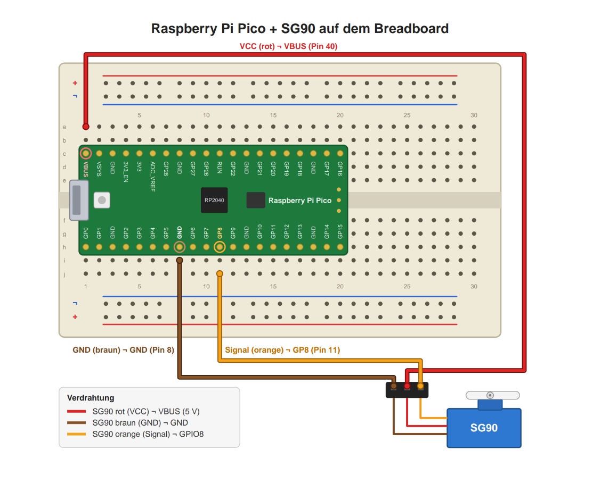

# Testprotokoll Parksystem mit Schranken

| Feld | Wert |
| --- | --- |
| Projekt | Parksystem mit Schranken, Modul M450, Auftrag A01-04 |
| Dokument | Testprotokoll |
| Version | Protokoll 0.1 |
| Bearbeitungsdatum | 12.11.2026 |
| Dokumentstatus | in Arbeit |
| Klassifizierung | nicht klassifiziert |
| Autor | Adam Mehila |
| Gruppe | Gruppe Mehila, Einzelarbeit. Mitgewirkt hat nur Adam Mehila |
| Modul | M450 Applikationen testen (ELA), Klasse INA24b |
| Auftraggeber | Parkhausbesitzer (fiktiv), vertreten durch die Lehrperson M450 (ELA) |

<!-- SEITENUMBRUCH -->

<!-- INHALTSVERZEICHNIS -->

## 0 Einleitung

### 0.1 Ziel und Zweck des Dokuments

Dieses Testprotokoll hält fest, wie das Parksystem getestet wurde und was dabei herauskam. Die Ergebnisse sind nach den Fehlerklassen des Testkonzepts bewertet.

Das Protokoll beantwortet für den Auftraggeber eine Frage: Kann das Parksystem in Betrieb genommen werden? Die Antwort steht in Kapitel 1 und ausführlich in Kapitel 9.

Grundlage ist Testkonzept 1.1. Es besteht aus Testkonzept 1.0 und einem Nachtrag mit korrigierten und neuen Testfällen. Der Nachtrag ist vollständig in Anhang A enthalten.

### 0.2 Referenzierte Dokumente

| Nr. | Titel | Version | Datum |
| --- | --- | --- | --- |
| [1] | Testkonzept Parksystem mit Schranken | Testkonzept 1.0 | 25.09.2026 |
| [2] | Testkonzept Parksystem mit Schranken, Nachtrag (Anhang A) | Testkonzept 1.1 | 12.11.2026 |
| [3] | User Stories Parksystem mit Schranken | ohne Versionsangabe | 07.09.2026 |
| [4] | Bewertung Testkonzept M450 INA24b | ohne Versionsangabe | 29.10.2026 |
| [5] | Auftrag A01-03 Implementierung Parkhaus mit Schranke | ohne Versionsangabe | ohne Datumsangabe |
| [6] | Auftrag A01-04 Testdurchführung und Testprotokoll Parksystem | ohne Versionsangabe | Abgabe 14.11.2026 |
| [7] | Firmware Parksystem, Git-Repository ParkhausSchranken, Branch Testprotokoll | Firmware 1.0 (Commit 867aed7) | 12.11.2026 |
| [8] | HERMES-Ergebnisvorlage Testprotokoll | ohne Versionsangabe | 26.01.2026 |

### 0.3 Mitgeltende Unterlagen

| Titel | Version | Stand |
| --- | --- | --- |
| Parkhaus mit Schranke (README des Projekts) | ohne Versionsangabe | Repository, Branch Testprotokoll |
| Projekt einrichten und starten (Anleitung) | ohne Versionsangabe | Repository, Branch Testprotokoll |
| Das Parkhaus-Projekt verstehen (Erklärung des Codes) | ohne Versionsangabe | Repository, Branch Testprotokoll |

### 0.4 Definitionen und Abkürzungen

| Begriff | Bedeutung |
| --- | --- |
| AK | Akzeptanzkriterium einer User Story. AK 3.3 heisst User Story 3, Akzeptanzkriterium 3 |
| Fehler-ID | Kennung eines gefundenen Fehlers, F-01 bis F-nn |
| H-01 bis H-05 | Testhilfen in der Firmware, siehe Kapitel 7.1 |
| Kasse-Seite | Weboberfläche von Pico 1 im Browser |
| M01 bis M25 | Meldungen aus dem Meldungskatalog, Testkonzept 1.1, Kapitel 5.4 |
| MK | Mängelklasse, entspricht der Fehlerklasse 1 bis 4 aus Testkonzept 1.0, Kapitel 6 |
| Pico 1 | Raspberry Pi Pico W mit der Kasse |
| Pico 2 | Raspberry Pi Pico W mit den Schranken und dem Servo |
| Produktivbuild | Firmware ohne Testwerkzeuge (TEST_BUILD=0) |
| Schranken-Seite | Weboberfläche von Pico 2 im Browser |
| Test-Build | Firmware mit Testwerkzeugen (TEST_BUILD=1) |
| Zyklus | ein vollständiger Durchgang durch die Testfälle |
| Z1 bis Z5 | Testziele aus Testkonzept 1.0, Kapitel 1.1 |
| ‹OFFEN› | Wert noch nicht beobachtet oder noch nicht bekannt |

### 0.5 Vorgaben, Methoden und Werkzeuge

| Titel | Vorgabe, Methode oder Werkzeug | Version |
| --- | --- | --- |
| Vorlage | HERMES-Ergebnisvorlage Testprotokoll | ohne Versionsangabe, 26.01.2026 |
| Testgrundlage | Testkonzept Parksystem mit Schranken | Testkonzept 1.1 |
| Entwicklungsumgebung und serieller Monitor | Visual Studio Code mit PlatformIO | PlatformIO Core 6.2.0 |
| Browser für alle Tests | Google Chrome | ‹OFFEN› |
| Versionsverwaltung | Git | Branch Testprotokoll |
| Zeitmessung | Stoppuhr auf dem Handy, Zeitstempel im seriellen Monitor | |
| Erzeugung des PDF | Python mit Modul markdown, Microsoft Edge im Hintergrundmodus | Edge 157.0.4341.46 |

## 1 Zusammenfassung und Empfehlung

Empfehlung der Testleitung: ‹OFFEN›

| Kennzahl | Zyklus 1 | Zyklus 2 |
| --- | --- | --- |
| Ausgeführte Testfälle | ‹OFFEN› | ‹OFFEN› |
| bestanden | ‹OFFEN› | ‹OFFEN› |
| nicht bestanden | ‹OFFEN› | ‹OFFEN› |
| nicht durchgeführt | ‹OFFEN› | ‹OFFEN› |
| Offene Fehler Klasse 1 und 2 | ‹OFFEN› | ‹OFFEN› |
| Offene Fehler Klasse 3 und 4 | ‹OFFEN› | ‹OFFEN› |

Wichtigste Restrisiken für den Betrieb: siehe Kapitel 9.2. ‹OFFEN›

## 2 Identifikation

### 2.1 Testobjekt

Getestet wird das Parksystem mit Schranken aus Auftrag A01-03. Es besteht aus zwei Raspberry Pi Pico W:

- Pico 1 ist die Kasse. Er speichert alle Parkvorgänge, berechnet die Gebühr und nimmt die Bezahlung entgegen.
- Pico 2 steuert die Schranken. Er nimmt Einfahrt und Ausfahrt entgegen, fragt vor jeder Ausfahrt bei Pico 1 den Bezahlstatus ab und bewegt den Servo.

Beide Picos haben eine Weboberfläche, die im Browser des Testlaptops geöffnet wird. Das Eintippen des Kennzeichens ersetzt die Kamera.

### 2.2 Getestete Stände

| Einsatz | Firmware | Commit | Build | Umgebungen | Geflasht am |
| --- | --- | --- | --- | --- | --- |
| Zyklus 1 | Firmware 1.0 | 867aed7 | Test-Build (TEST_BUILD=1) | pico1_cashdesk, pico2_barriers | ‹OFFEN› |
| Zyklus 2 | ‹OFFEN› | ‹OFFEN› | Test-Build (TEST_BUILD=1) | pico1_cashdesk, pico2_barriers | ‹OFFEN› |
| T30 | ‹OFFEN› | ‹OFFEN› | Produktivbuild (TEST_BUILD=0) | pico1_cashdesk_prod, pico2_barriers_prod | ‹OFFEN› |

Die Netzwerkwerte (WLAN-Name, Adressen) stehen nur lokal in der Konfigurationsdatei und sind nicht Teil der Commits. Das WLAN-Passwort wird nirgends dokumentiert.

### 2.3 Bezug zum Testkonzept

Getestet wird gegen Testkonzept 1.1 (Anhang A). Es übernimmt Testziele, Teststufe, Rollen und Fehlerklassifizierung aus Testkonzept 1.0. Es passt die Testumgebung an die Umsetzung an, beschreibt Testwerkzeuge und Ablauf und enthält die Testfälle T01 bis T30. T01 bis T24 sind präzisiert, T25 bis T30 sind neu. Kapitel 7.2 nennt die Gründe.

## 3 Testumgebung und Tester

### 3.1 Ort

| Zyklus | Ort |
| --- | --- |
| Zyklus 1 | ‹OFFEN› |
| Zyklus 2 | ‹OFFEN› |

### 3.2 Hardware

| Komponente | Ist |
| --- | --- |
| Pico 1 (Kasse) | Raspberry Pi Pico W, Strom über USB vom Testlaptop |
| Pico 2 (Schranken) | Raspberry Pi Pico W, Strom über USB vom Testlaptop |
| Servo | ein SG90 an GP8 (Pin 11), VBUS (Pin 40), GND (Pin 8). Einfahrt und Ausfahrt teilen sich den Arm |
| Stellungen | zu: 90 Grad, Arm waagrecht. Offen: 0 Grad, Arm senkrecht |
| Testlaptop | Windows 11 Pro 10.0.26300 |
| Stoppuhr | Handy |

### 3.3 Netzwerk

| Angabe | Ist |
| --- | --- |
| WLAN-Name (2,4 GHz) | ‹OFFEN› |
| Pico 1 (Kasse) | ‹OFFEN› |
| Pico 2 (Schranken) | ‹OFFEN› |
| Gateway, Subnetzmaske | ‹OFFEN› |
| Testlaptop | im selben WLAN |

### 3.4 Software

| Software | Ist |
| --- | --- |
| Browser | Google Chrome ‹OFFEN› |
| Entwicklungsumgebung | Visual Studio Code mit PlatformIO Core 6.2.0 |
| Serieller Monitor | `pio device monitor --port COMx --filter time --filter log2file` |
| COM-Port Pico 1 | ‹OFFEN› |
| COM-Port Pico 2 | ‹OFFEN› |

### 3.5 Rollen und Personen

| Rolle | Aufgabe | Person |
| --- | --- | --- |
| Testleitung | Plant den Ablauf, prüft die Eingangskriterien, vergibt die Fehlerklassen, empfiehlt die Inbetriebnahme | Adam Mehila |
| Tester Einfahrt und Ausfahrt | Bedient die Schranken-Seite, misst Zeiten, beobachtet Servo und Monitor von Pico 2 | Adam Mehila |
| Tester Kasse | Bedient die Kasse-Seite, prüft Gebühren und Listen, beobachtet den Monitor von Pico 1 | Adam Mehila |
| Entwicklung | Behebt Fehler, liefert neue Firmware-Versionen, erstellt die Build-Nachweise | Adam Mehila |
| Auftraggeber | Entscheidet über die Inbetriebnahme | Parkhausbesitzer (fiktiv), vertreten durch die Lehrperson M450 (ELA) |

Hilfsmittel: Die Testhilfen H-01 bis H-05 und die Entwürfe der Testdokumente sind mit Unterstützung von Claude Code (KI-Assistent) entstanden. Prüfung, Testdurchführung und Verantwortung liegen bei Adam Mehila.

### 3.6 Zeitpunkte der Durchführung

| Zyklus | Datum | Beginn | Ende |
| --- | --- | --- | --- |
| Zyklus 1 | ‹OFFEN› | ‹OFFEN› | ‹OFFEN› |
| Zyklus 2 | ‹OFFEN› | ‹OFFEN› | ‹OFFEN› |
| T30 (Abnahme) | ‹OFFEN› | ‹OFFEN› | ‹OFFEN› |

### 3.7 Eingangskriterien

| Kriterium (Testkonzept 1.1, Kapitel 7.5) | Zyklus 1 | Zyklus 2 |
| --- | --- | --- |
| Beide Picos mit dem getesteten Stand geflasht, Banner zeigt die Firmware-Version | ‹OFFEN› | ‹OFFEN› |
| Monitor für jeden Pico mit Zeitstempel und Logdatei offen | ‹OFFEN› | ‹OFFEN› |
| Kasse-Seite zuerst geöffnet, Monitor zeigt `[KASSE] Uhr gestellt: ...`, danach Schranken-Seite geöffnet | ‹OFFEN› | ‹OFFEN› |
| Beide Seiten laden in Chrome innerhalb von 3 s | ‹OFFEN› | ‹OFFEN› |
| Servo-Test: Meldung M23, Arm geht hoch und nach 5 s wieder runter | ‹OFFEN› | ‹OFFEN› |
| Reset: Meldung M22, Belegung "0 / 3" auf beiden Seiten | ‹OFFEN› | ‹OFFEN› |

### 3.8 Testwerkzeuge und Beobachtung

Aufruf, Antwort und Regeln der Testwerkzeuge stehen in Testkonzept 1.1, Kapitel 4.4. Die Orte der Beobachtung und die Monitorzeilen stehen in Kapitel 4.5 und 4.6. Die Statusabfrage von Pico 2 an Pico 1 ist auf beiden Seiten sichtbar: Pico 1 zeigt `[KASSE] Statusabfrage von Pico 2: KENNZEICHEN -> STATUS`, Pico 2 zeigt `[AUSFAHRT] Kasse meldet fuer KENNZEICHEN: STATUS`.

## 4 Abweichungen der Umsetzung vom Testkonzept

Grundsätzlich gelten Testumgebung, Rollen und Testfälle aus dem Testkonzept. Diese Tabelle nennt jede Abweichung.

| Nr. | Bereich | Testkonzept 1.0 | Umsetzung oder Durchführung | Begründung | Behandlung in Testkonzept 1.1 |
| --- | --- | --- | --- | --- | --- |
| A01 | Hardware | zwei Servos, Einfahrt an GPIO 15, Ausfahrt an GPIO 16 | ein Servo an GP8 für Einfahrt und Ausfahrt | Umsetzung mit einem Servo nach dem Verkabelungsbeispiel aus Auftrag A01-03. Einfahrt und Ausfahrt sind nur über die Meldungen unterscheidbar | Kapitel 4.1, Soll-Werte der Testfälle angepasst |
| A02 | Hardware | zu bei 0 Grad, offen bei 90 Grad | zu bei 90 Grad, offen bei 0 Grad | Der Arm sitzt anders auf der Achse. Waagrecht bleibt zu, senkrecht bleibt offen | Kapitel 4.1 |
| A03 | Hardware | Kartonstreifen als Schrankenarm | mitgelieferter Arm des SG90 | Arm war vorhanden | Kapitel 4.1 |
| A04 | Netzwerk | WLAN PARK-TEST-NET, Pico 1 auf 192.168.4.11, Pico 2 auf 192.168.4.12 | ‹OFFEN› | ‹OFFEN› | Kapitel 4.2 |
| A05 | Software | "Version 1.0 des Test-Builds", ohne Kennung im Gerät | Firmware 1.0 mit den Testhilfen H-01 bis H-05, Commit 867aed7, Version im Banner | Der getestete Stand muss eindeutig erkennbar sein | Kapitel 4.3 |
| A06 | Testwerkzeuge | nur der Endpunkt zur Zeitmanipulation, ohne Aufruf | zusätzlich Reset, Kasse stumm schalten, Servo-Test, Gebühr für exakte Dauer, jeweils mit Aufruf und Antwort | Ausgangszustand, T13 und T23 brauchen sie | Kapitel 4.4 |
| A07 | T23 | WLAN-Router für 30 s ausschalten | Pico 1 beantwortet 30 s lang keine Anfragen (Testhilfe H-04) | Ein ausgeschalteter Router trennt auch den Laptop, die Ausfahrt liesse sich nicht auslösen | T23, Kapitel 6 |
| A08 | Ablauf | alle Testfälle in der Reihenfolge der ID | T29 zuerst, die Wartezeit von 16 Minuten wird für andere Testfälle genutzt. Reset vor jedem Block | T29 braucht echte Wartezeit. Die Vorbedingungen der Testfälle passen nicht zur Reihenfolge der ID | Kapitel 7.4 und 7.5 |
| A09 | Zeitplan | zwei Zyklen im Abstand einer Woche, jeweils Donnerstag 14:05 bis 15:50 | beide Zyklen bis zur Abgabe am 14.11.2026 | Abgabetermin | Kapitel 7.1 |
| A10 | Zyklus 2 | Retest der fehlerhaften Testfälle und Regression über alle Testfälle mit Priorität Hoch | vollständiger Durchlauf T01 bis T29, danach T30 | Die Regression für die geplanten Behebungen umfasst ohnehin fast alle Testfälle (Kapitel 7.4) | Kapitel 7.1 |
| A11 | Messmethode T05 | Stoppuhr | Stoppuhr und Zeitstempel im seriellen Monitor | genauer als die Reaktionszeit beim Stoppen | T05 |
| A12 | Umfang | Akzeptanzkriterium 2.3 (Erkennung dauert zu lange) ohne Testfall | nicht anwendbar | Es gibt keine Kennzeichenerkennung | Kapitel 6 |
| A13 | Testfälle | T01 bis T24 | T01 bis T24 präzisiert, T25 bis T30 neu | Bemerkungen aus der Bewertung, fehlende Akzeptanzkriterien, Abnahme des Produktivbuilds | Kapitel 8 |
| A14 | Dokumentation | Das README sagt, im Produktivbuild seien die Testwerkzeuge "gar nicht mehr in der Firmware enthalten" | Die Endpunkte fehlen, die Karten der Testwerkzeuge sind nur ausgeblendet | Laut Code bleibt das HTML der Karten in der Seite | T30 prüft Sichtbarkeit und Endpunkte |

## 5 Testdurchführung Zyklus 1

Stand: Firmware 1.0, Test-Build, Commit 867aed7. Reihenfolge nach der Checkliste in Testkonzept 1.1, Kapitel 7.5. Alle Testfälle führt Adam Mehila aus.

<!-- QUERFORMAT-ANFANG -->

### 5.1 Übersicht Zyklus 1

| ID | Bezeichnung | Datum, Uhrzeit | Erwartet (kurz) | Tatsächlich (kurz) | Status | MK |
| --- | --- | --- | --- | --- | --- | --- |
| T01 | Gültiges Kennzeichen bei der Einfahrt | ‹OFFEN› | M04, Arm offen in höchstens 3 s, zu nach 5 s ± 1 s, Belegung 1 / 3 | ‹OFFEN› | ‹OFFEN› | ‹OFFEN› |
| T02 | Einfahrtszeit stimmt mit der Laptop-Uhr | ‹OFFEN› | Abweichung höchstens 1 Minute | ‹OFFEN› | ‹OFFEN› | ‹OFFEN› |
| T03 | Erneute Einfahrt nach Abschluss | ‹OFFEN› | neuer Eintrag, alter Eintrag bleibt erhalten | ‹OFFEN› | ‹OFFEN› | ‹OFFEN› |
| T04 | Einfahrtsschranke öffnet in 3 s | ‹OFFEN› | Arm senkrecht in höchstens 3,0 s | ‹OFFEN› | ‹OFFEN› | ‹OFFEN› |
| T05 | Einfahrtsschranke schliesst nach 5 s | ‹OFFEN› | 5,0 s ± 1,0 s | ‹OFFEN› | ‹OFFEN› | ‹OFFEN› |
| T06 | Leeres Kennzeichen | ‹OFFEN› | M01, Arm bleibt zu | ‹OFFEN› | ‹OFFEN› | ‹OFFEN› |
| T07 | Sonderzeichen | ‹OFFEN› | M03, Arm bleibt zu | ‹OFFEN› | ‹OFFEN› | ‹OFFEN› |
| T08 | Überlange Eingabe | ‹OFFEN› | M02, kein Neustart | ‹OFFEN› | ‹OFFEN› | ‹OFFEN› |
| T09 | Letzter freier Platz | ‹OFFEN› | M04, Belegung 3 / 3 | ‹OFFEN› | ‹OFFEN› | ‹OFFEN› |
| T10 | Parkhaus voll | ‹OFFEN› | M06, Arm bleibt zu | ‹OFFEN› | ‹OFFEN› | ‹OFFEN› |
| T11 | Platz nach Ausfahrt frei | ‹OFFEN› | M11, Belegung 2 / 3, dann 3 / 3 | ‹OFFEN› | ‹OFFEN› | ‹OFFEN› |
| T12 | Gebühr nach 1 Minute | ‹OFFEN› | "0 h 01 min", CHF 2.00 | ‹OFFEN› | ‹OFFEN› | ‹OFFEN› |
| T13 | Gebühr an der Stundengrenze | ‹OFFEN› | 59 min und genau 60 min CHF 2.00, 61 min CHF 4.00 | ‹OFFEN› | ‹OFFEN› | ‹OFFEN› |
| T14 | Gebühr nach 3 h 15 min | ‹OFFEN› | CHF 8.00 | ‹OFFEN› | ‹OFFEN› | ‹OFFEN› |
| T15 | Unbekanntes Kennzeichen an der Kasse | ‹OFFEN› | M15, Bezahlen ausgegraut | ‹OFFEN› | ‹OFFEN› | ‹OFFEN› |
| T16 | Bezahlung erfolgreich | ‹OFFEN› | M16 CHF 2.00, M18 | ‹OFFEN› | ‹OFFEN› | ‹OFFEN› |
| T17 | Doppelte Bezahlung verhindert | ‹OFFEN› | M17, Bezahlen ausgegraut, M19 ohne zweite Buchung | ‹OFFEN› | ‹OFFEN› | ‹OFFEN› |
| T18 | Bezahlung unbekanntes Kennzeichen | ‹OFFEN› | M15, Bezahlen ausgegraut, M20 | ‹OFFEN› | ‹OFFEN› | ‹OFFEN› |
| T19 | Ausfahrt nach Bezahlung | ‹OFFEN› | Statusabfrage paid, M11, Arm offen in höchstens 3 s | ‹OFFEN› | ‹OFFEN› | ‹OFFEN› |
| T20 | Ausfahrt ohne Bezahlung | ‹OFFEN› | M10, Arm bleibt zu, nach Bezahlung M11 | ‹OFFEN› | ‹OFFEN› | ‹OFFEN› |
| T21 | Bezahlt, Kennzeichen anders | ‹OFFEN› | M09 für BE 55512, M11 für BE 55511 | ‹OFFEN› | ‹OFFEN› | ‹OFFEN› |
| T22 | Kompletter Durchlauf | ‹OFFEN› | CHF 4.00, M18, M11, Belegung 0 / 3 | ‹OFFEN› | ‹OFFEN› | ‹OFFEN› |
| T23 | Kasse fällt kurz aus | ‹OFFEN› | M08 in höchstens 5 s, kein Neustart, danach M11 | ‹OFFEN› | ‹OFFEN› | ‹OFFEN› |
| T24 | Kennzeichen erscheint an der Kasse | ‹OFFEN› | Eintrag in höchstens 3 s, Status offen | ‹OFFEN› | ‹OFFEN› | ‹OFFEN› |
| T25 | Doppelte Einfahrt | ‹OFFEN› | M05, Belegung unverändert | ‹OFFEN› | ‹OFFEN› | ‹OFFEN› |
| T26 | Kennzeichenformat | ‹OFFEN› | 3 mal M04, 5 mal M03, 1 mal M02 | ‹OFFEN› | ‹OFFEN› | ‹OFFEN› |
| T27 | Fehlversuch mit Datum und Uhrzeit | ‹OFFEN› | Liste "Fehlversuche" mit 3 Zeilen | ‹OFFEN› | ‹OFFEN› | ‹OFFEN› |
| T28 | Zahlungszeitpunkt | ‹OFFEN› | "Bezahlt am", Abweichung höchstens 1 Minute | ‹OFFEN› | ‹OFFEN› | ‹OFFEN› |
| T29 | Nachberechnung nach Zeitfenster | ‹OFFEN› | nach 14 min bezahlt, nach 16 min offen CHF 2.00, M10, nach Nachzahlung M11 | ‹OFFEN› | ‹OFFEN› | ‹OFFEN› |

<!-- QUERFORMAT-ENDE -->

### 5.2 Einzelprotokolle Zyklus 1

Jedes Einzelprotokoll nennt das erwartete Ergebnis aus Testkonzept 1.1 in Kurzform. Massgebend ist der vollständige Testfall in Anhang A.

#### T29 Gebühr wird nach Ablauf des Zeitfensters nachberechnet (Zyklus 1, Start)

| Feld | Eintrag |
| --- | --- |
| Datum, Uhrzeit | ‹OFFEN› |
| Tester | Adam Mehila (Tester Kasse, Tester Einfahrt und Ausfahrt) |
| Stand, Browser | Firmware 1.0, Test-Build, Commit 867aed7, Chrome ‹OFFEN› |
| Ausgangszustand | Soll: leer nach Reset. Hergestellt: ‹OFFEN› |
| Eingaben | SG 11122, Einfahrtszeit um 50 Minuten verschoben |
| Erwartet | Schritte 1 bis 3: M04, Meldung der Testwerkzeuge mit CHF 2.00, Parkdauer 0 h 50 min bis 0 h 59 min, M16 CHF 2.00, M18 CHF 2.00 |
| Tatsächlich | ‹OFFEN› |
| Messwerte | Zahlungszeit Z ‹OFFEN›, Parkdauer P ‹OFFEN› |
| Nachweise | ‹OFFEN› |

Die Bewertung von T29 steht beim zweiten Teil weiter unten.

#### T06 Leeres Kennzeichen wird abgelehnt (Zyklus 1)

| Feld | Eintrag |
| --- | --- |
| Datum, Uhrzeit | ‹OFFEN› |
| Tester | Adam Mehila (Tester Einfahrt und Ausfahrt) |
| Stand, Browser | Firmware 1.0, Test-Build, Commit 867aed7, Chrome ‹OFFEN› |
| Ausgangszustand | Soll: beliebig. Ist: ‹OFFEN› |
| Eingaben | leeres Feld |
| Erwartet | M01, Arm bleibt zu, Monitor Pico 2 `[EINGABE] Abgelehnt, ungueltiges Kennzeichen. Laenge: 0`, Kasse unverändert |
| Tatsächlich | ‹OFFEN› |
| Messwerte | keine Messung |
| Status | ‹OFFEN› |
| Fehler-ID, Klasse | ‹OFFEN› |
| Nachweise | ‹OFFEN› |

#### T07 Kennzeichen mit Sonderzeichen wird abgelehnt (Zyklus 1)

| Feld | Eintrag |
| --- | --- |
| Datum, Uhrzeit | ‹OFFEN› |
| Tester | Adam Mehila (Tester Einfahrt und Ausfahrt) |
| Stand, Browser | Firmware 1.0, Test-Build, Commit 867aed7, Chrome ‹OFFEN› |
| Ausgangszustand | Soll: beliebig. Ist: ‹OFFEN› |
| Eingaben | `!@#$%^&*()` |
| Erwartet | M03, Arm bleibt zu, Monitor Pico 2 `[EINGABE] Abgelehnt, ungueltiges Kennzeichen. Laenge: 10`, Kasse unverändert |
| Tatsächlich | ‹OFFEN› |
| Messwerte | keine Messung |
| Status | ‹OFFEN› |
| Fehler-ID, Klasse | ‹OFFEN› |
| Nachweise | ‹OFFEN› |

#### T08 Überlange Eingabe wird abgelehnt (Zyklus 1)

| Feld | Eintrag |
| --- | --- |
| Datum, Uhrzeit | ‹OFFEN› |
| Tester | Adam Mehila (Tester Einfahrt und Ausfahrt) |
| Stand, Browser | Firmware 1.0, Test-Build, Commit 867aed7, Chrome ‹OFFEN› |
| Ausgangszustand | Soll: beliebig. Ist: ‹OFFEN› |
| Eingaben | 30 mal A |
| Erwartet | M02, Arm bleibt zu, Monitor Pico 2 `[EINGABE] Abgelehnt, ungueltiges Kennzeichen. Laenge: 30`, kein neues Banner |
| Tatsächlich | ‹OFFEN› |
| Messwerte | keine Messung |
| Status | ‹OFFEN› |
| Fehler-ID, Klasse | ‹OFFEN› |
| Nachweise | ‹OFFEN› |

#### T27 Fehlversuch wird mit Datum und Uhrzeit festgehalten (Zyklus 1)

| Feld | Eintrag |
| --- | --- |
| Datum, Uhrzeit | ‹OFFEN› |
| Tester | Adam Mehila (Tester Einfahrt und Ausfahrt) |
| Stand, Browser | Firmware 1.0, Test-Build, Commit 867aed7, Chrome ‹OFFEN› |
| Ausgangszustand | Soll: Schranken-Seite seit dem Start von Pico 2 geöffnet. Ist: ‹OFFEN› |
| Eingaben | leeres Feld, 30 mal A, `!@#$%^&*()` |
| Erwartet | M01, M02, M03. Liste "Fehlversuche" mit Datum, Uhrzeit, Eingabe und Grund, drei Zeilen, neueste oben, Uhrzeit höchstens 1 Minute Abweichung |
| Tatsächlich | ‹OFFEN› |
| Messwerte | notierte Uhrzeiten der drei Klicks ‹OFFEN› |
| Status | ‹OFFEN› |
| Fehler-ID, Klasse | ‹OFFEN› |
| Nachweise | ‹OFFEN› |

#### T15 Unbekanntes Kennzeichen an der Kasse (Zyklus 1)

| Feld | Eintrag |
| --- | --- |
| Datum, Uhrzeit | ‹OFFEN› |
| Tester | Adam Mehila (Tester Kasse) |
| Stand, Browser | Firmware 1.0, Test-Build, Commit 867aed7, Chrome ‹OFFEN› |
| Ausgangszustand | Soll: UR 99988 nicht im Parkhaus. Ist: ‹OFFEN› |
| Eingaben | UR 99988 |
| Erwartet | M15 mit UR 99988, keine Angaben zu Einfahrt, Parkdauer und Gebühr, Bezahlen ausgegraut |
| Tatsächlich | ‹OFFEN› |
| Messwerte | keine Messung |
| Status | ‹OFFEN› |
| Fehler-ID, Klasse | ‹OFFEN› |
| Nachweise | ‹OFFEN› |

#### T18 Bezahlung für unbekanntes Kennzeichen (Zyklus 1)

| Feld | Eintrag |
| --- | --- |
| Datum, Uhrzeit | ‹OFFEN› |
| Tester | Adam Mehila (Tester Kasse) |
| Stand, Browser | Firmware 1.0, Test-Build, Commit 867aed7, Chrome ‹OFFEN› |
| Ausgangszustand | Soll: ZG 77766 nicht im Parkhaus. Ist: ‹OFFEN› |
| Eingaben | ZG 77766, Aufruf /api/pay?plate=ZG%2077766 |
| Erwartet | M15 mit ZG 77766, Bezahlen ausgegraut, Antwort mit M20 und `"ok":false`, keine Zeile `[KASSE] Bezahlt` |
| Tatsächlich | ‹OFFEN› |
| Messwerte | keine Messung |
| Status | ‹OFFEN› |
| Fehler-ID, Klasse | ‹OFFEN› |
| Nachweise | ‹OFFEN› |

#### T25 Kennzeichen fährt ein, obwohl es schon im Parkhaus steht (Zyklus 1)

| Feld | Eintrag |
| --- | --- |
| Datum, Uhrzeit | ‹OFFEN› |
| Tester | Adam Mehila (Tester Einfahrt und Ausfahrt) |
| Stand, Browser | Firmware 1.0, Test-Build, Commit 867aed7, Chrome ‹OFFEN› |
| Ausgangszustand | Soll: LU 12345 im Parkhaus, zusätzlich SG 11122 aus T29. Ist: ‹OFFEN› |
| Eingaben | LU 12345, lu12345 |
| Erwartet | zweimal M05, Arm bleibt zu, Belegung unverändert, eine Zeile LU 12345, keine neue Zeile `[KASSE] Einfahrt: LU 12345` |
| Tatsächlich | ‹OFFEN› |
| Messwerte | keine Messung |
| Status | ‹OFFEN› |
| Fehler-ID, Klasse | ‹OFFEN› |
| Nachweise | ‹OFFEN› |

#### T29 Gebühr wird nach Ablauf des Zeitfensters nachberechnet (Zyklus 1, Fortsetzung)

| Feld | Eintrag |
| --- | --- |
| Datum, Uhrzeit | ‹OFFEN› |
| Tester | Adam Mehila (Tester Kasse, Tester Einfahrt und Ausfahrt) |
| Stand, Browser | Firmware 1.0, Test-Build, Commit 867aed7, Chrome ‹OFFEN› |
| Ausgangszustand | Soll: SG 11122 bezahlt um Z, kein Reset und kein Neustart von Pico 1 seither. Ist: ‹OFFEN› |
| Eingaben | SG 11122 |
| Erwartet | Bei Z plus 14 Minuten: Parkdauer P plus 14 Minuten, Status "bezahlt", M17. Bei Z plus 16 Minuten: Status "offen", M16 CHF 2.00. Ausfahrt: M10 mit CHF 2.00. Nach Nachzahlung (M18 CHF 2.00): M11 |
| Tatsächlich | ‹OFFEN› |
| Messwerte | Uhrzeiten der Suchen ‹OFFEN›, angezeigte Parkdauern ‹OFFEN› |
| Status | ‹OFFEN› |
| Fehler-ID, Klasse | ‹OFFEN› |
| Nachweise | ‹OFFEN› |

#### T01 Gültiges Kennzeichen bei der Einfahrt eintippen (Zyklus 1)

| Feld | Eintrag |
| --- | --- |
| Datum, Uhrzeit | ‹OFFEN› |
| Tester | Adam Mehila (Tester Einfahrt und Ausfahrt, Tester Kasse) |
| Stand, Browser | Firmware 1.0, Test-Build, Commit 867aed7, Chrome ‹OFFEN› |
| Ausgangszustand | Soll: leer nach Reset. Hergestellt: ‹OFFEN› |
| Eingaben | LU 12345 |
| Erwartet | M04, Arm offen in höchstens 3 s und zu nach 5 s ± 1 s, Monitorzeilen `[SCHRANKE] ...` und `[KASSE] Einfahrt: LU 12345  Belegung: 1/3`, Eintrag mit Datum und Uhrzeit, Belegung 1 / 3 |
| Tatsächlich | ‹OFFEN› |
| Messwerte | Uhrzeit des Klicks ‹OFFEN› |
| Status | ‹OFFEN› |
| Fehler-ID, Klasse | ‹OFFEN› |
| Nachweise | ‹OFFEN› |

#### T02 Einfahrtszeit stimmt mit der Uhrzeit des Laptops überein (Zyklus 1)

| Feld | Eintrag |
| --- | --- |
| Datum, Uhrzeit | ‹OFFEN› |
| Tester | Adam Mehila (Tester Kasse) |
| Stand, Browser | Firmware 1.0, Test-Build, Commit 867aed7, Chrome ‹OFFEN› |
| Ausgangszustand | Soll: nach T01. Ist: ‹OFFEN› |
| Eingaben | LU 12345, Uhrzeit des Klicks aus T01 |
| Erwartet | gleiches Datum, Uhrzeit höchstens 1 Minute Abweichung |
| Tatsächlich | ‹OFFEN› |
| Messwerte | angezeigte Einfahrt ‹OFFEN›, Abweichung ‹OFFEN› |
| Status | ‹OFFEN› |
| Fehler-ID, Klasse | ‹OFFEN› |
| Nachweise | ‹OFFEN› |

#### T03 Gleiches Kennzeichen fährt nach abgeschlossenem Vorgang erneut ein (Zyklus 1)

| Feld | Eintrag |
| --- | --- |
| Datum, Uhrzeit | ‹OFFEN› |
| Tester | Adam Mehila (Tester Einfahrt und Ausfahrt, Tester Kasse) |
| Stand, Browser | Firmware 1.0, Test-Build, Commit 867aed7, Chrome ‹OFFEN› |
| Ausgangszustand | Soll: LU 12345 bezahlt und ausgefahren, Belegung 0 / 3. Hergestellt: ‹OFFEN› |
| Eingaben | LU 12345 |
| Erwartet | M04, neue Zeile unter "Fahrzeuge im Parkhaus", alte Zeile unverändert unter "Abgeschlossene Vorgänge", Belegung 1 / 3 |
| Tatsächlich | ‹OFFEN› |
| Messwerte | keine Messung |
| Status | ‹OFFEN› |
| Fehler-ID, Klasse | ‹OFFEN› |
| Nachweise | ‹OFFEN› |

#### T04 Einfahrtsschranke öffnet innerhalb von 3 Sekunden (Zyklus 1)

| Feld | Eintrag |
| --- | --- |
| Datum, Uhrzeit | ‹OFFEN› |
| Tester | Adam Mehila (Tester Einfahrt und Ausfahrt) |
| Stand, Browser | Firmware 1.0, Test-Build, Commit 867aed7, Chrome ‹OFFEN› |
| Ausgangszustand | Soll: leer nach Reset. Hergestellt: ‹OFFEN› |
| Eingaben | ZH 98765 |
| Erwartet | Arm senkrecht höchstens 3,0 s nach dem Klick, M04, `[SCHRANKE] Schranke oeffnet (0 Grad).` |
| Tatsächlich | ‹OFFEN› |
| Messwerte | gemessene Zeit ‹OFFEN› |
| Status | ‹OFFEN› |
| Fehler-ID, Klasse | ‹OFFEN› |
| Nachweise | ‹OFFEN› |

#### T05 Einfahrtsschranke schliesst nach 5 Sekunden (Zyklus 1)

| Feld | Eintrag |
| --- | --- |
| Datum, Uhrzeit | ‹OFFEN› |
| Tester | Adam Mehila (Tester Einfahrt und Ausfahrt) |
| Stand, Browser | Firmware 1.0, Test-Build, Commit 867aed7, Chrome ‹OFFEN› |
| Ausgangszustand | Soll: direkt nach T04, Arm offen. Ist: ‹OFFEN› |
| Eingaben | keine |
| Erwartet | Differenz der Zeitstempel und Stoppuhr je 5,0 s ± 1,0 s, Arm danach waagrecht, Anzeige "geschlossen" |
| Tatsächlich | ‹OFFEN› |
| Messwerte | Zeitstempel öffnen und schliessen ‹OFFEN›, Stoppuhr ‹OFFEN› |
| Status | ‹OFFEN› |
| Fehler-ID, Klasse | ‹OFFEN› |
| Nachweise | ‹OFFEN› |

#### T09 Letzter freier Platz wird belegt (Zyklus 1)

| Feld | Eintrag |
| --- | --- |
| Datum, Uhrzeit | ‹OFFEN› |
| Tester | Adam Mehila (Tester Einfahrt und Ausfahrt, Tester Kasse) |
| Stand, Browser | Firmware 1.0, Test-Build, Commit 867aed7, Chrome ‹OFFEN› |
| Ausgangszustand | Soll: LU 12345 und ZH 98765 im Parkhaus, Belegung 2 / 3. Hergestellt: ‹OFFEN› |
| Eingaben | SG 11122 |
| Erwartet | M04, `[KASSE] Einfahrt: SG 11122  Belegung: 3/3`, Belegung 3 / 3 auf beiden Seiten |
| Tatsächlich | ‹OFFEN› |
| Messwerte | keine Messung |
| Status | ‹OFFEN› |
| Fehler-ID, Klasse | ‹OFFEN› |
| Nachweise | ‹OFFEN› |

#### T10 Einfahrt wird bei vollem Parkhaus verweigert (Zyklus 1)

| Feld | Eintrag |
| --- | --- |
| Datum, Uhrzeit | ‹OFFEN› |
| Tester | Adam Mehila (Tester Einfahrt und Ausfahrt, Tester Kasse) |
| Stand, Browser | Firmware 1.0, Test-Build, Commit 867aed7, Chrome ‹OFFEN› |
| Ausgangszustand | Soll: direkt nach T09, Belegung 3 / 3. Ist: ‹OFFEN› |
| Eingaben | TG 44499 |
| Erwartet | M06, Arm bleibt zu, keine Zeile `[KASSE] Einfahrt: TG 44499`, TG 44499 nicht in der Liste |
| Tatsächlich | ‹OFFEN› |
| Messwerte | keine Messung |
| Status | ‹OFFEN› |
| Fehler-ID, Klasse | ‹OFFEN› |
| Nachweise | ‹OFFEN› |

#### T11 Platz wird nach einer Ausfahrt wieder frei (Zyklus 1)

| Feld | Eintrag |
| --- | --- |
| Datum, Uhrzeit | ‹OFFEN› |
| Tester | Adam Mehila (Tester Einfahrt und Ausfahrt, Tester Kasse) |
| Stand, Browser | Firmware 1.0, Test-Build, Commit 867aed7, Chrome ‹OFFEN› |
| Ausgangszustand | Soll: Belegung 3 / 3, LU 12345 bezahlt. Hergestellt: ‹OFFEN› |
| Eingaben | LU 12345 (Ausfahrt), TG 44499 (Einfahrt) |
| Erwartet | M11, Monitorzeilen mit `paid`, Belegung 2 / 3, danach M04 für TG 44499 und Belegung 3 / 3 |
| Tatsächlich | ‹OFFEN› |
| Messwerte | keine Messung |
| Status | ‹OFFEN› |
| Fehler-ID, Klasse | ‹OFFEN› |
| Nachweise | ‹OFFEN› |

#### T12 Gebühr nach 1 Minute Parkdauer (Zyklus 1)

| Feld | Eintrag |
| --- | --- |
| Datum, Uhrzeit | ‹OFFEN› |
| Tester | Adam Mehila (Tester Kasse) |
| Stand, Browser | Firmware 1.0, Test-Build, Commit 867aed7, Chrome ‹OFFEN› |
| Ausgangszustand | Soll: leer nach Reset. Hergestellt: ‹OFFEN› |
| Eingaben | ZH 98765 |
| Erwartet | Suche zwischen 60 s und 119 s: Parkdauer "0 h 01 min", M16 "Offener Betrag: CHF 2.00" |
| Tatsächlich | ‹OFFEN› |
| Messwerte | Stoppuhrzeit der Suche ‹OFFEN› |
| Status | ‹OFFEN› |
| Fehler-ID, Klasse | ‹OFFEN› |
| Nachweise | ‹OFFEN› |

#### T13 Gebühr genau am Übergang zur zweiten Stunde (Zyklus 1)

| Feld | Eintrag |
| --- | --- |
| Datum, Uhrzeit | ‹OFFEN› |
| Tester | Adam Mehila (Tester Kasse) |
| Stand, Browser | Firmware 1.0, Test-Build, Commit 867aed7, Chrome ‹OFFEN› |
| Ausgangszustand | Soll: Reset, BE 55511 eingefahren. Hergestellt: ‹OFFEN› |
| Eingaben | BE 55511, Verschiebung 59, 60 und 61 Minuten |
| Erwartet | 59 min: "0 h 59 min", CHF 2.00. Genau 60 min (Meldung der Testwerkzeuge): CHF 2.00. 61 min: "1 h 01 min", CHF 4.00 |
| Tatsächlich | ‹OFFEN› |
| Messwerte | keine Messung |
| Status | ‹OFFEN› |
| Fehler-ID, Klasse | ‹OFFEN› |
| Nachweise | ‹OFFEN› |

#### T14 Gebühr für eine längere Parkdauer (Zyklus 1)

| Feld | Eintrag |
| --- | --- |
| Datum, Uhrzeit | ‹OFFEN› |
| Tester | Adam Mehila (Tester Kasse) |
| Stand, Browser | Firmware 1.0, Test-Build, Commit 867aed7, Chrome ‹OFFEN› |
| Ausgangszustand | Soll: Reset, SG 11122 eingefahren. Hergestellt: ‹OFFEN› |
| Eingaben | SG 11122, Verschiebung 195 Minuten |
| Erwartet | Meldung mit "Gebühr für genau 3 h 15 min: CHF 8.00", Suche: "3 h 15 min", M16 CHF 8.00 |
| Tatsächlich | ‹OFFEN› |
| Messwerte | keine Messung |
| Status | ‹OFFEN› |
| Fehler-ID, Klasse | ‹OFFEN› |
| Nachweise | ‹OFFEN› |

#### T16 Bezahlung erfolgreich durchführen (Zyklus 1)

| Feld | Eintrag |
| --- | --- |
| Datum, Uhrzeit | ‹OFFEN› |
| Tester | Adam Mehila (Tester Kasse) |
| Stand, Browser | Firmware 1.0, Test-Build, Commit 867aed7, Chrome ‹OFFEN› |
| Ausgangszustand | Soll: Reset, LU 12345 eingefahren, Parkdauer unter 60 Minuten. Hergestellt: ‹OFFEN› |
| Eingaben | LU 12345 |
| Erwartet | M16 CHF 2.00, nach dem Klick M18 "Bezahlung erfolgt. Betrag: CHF 2.00.", Status "bezahlt", Bezahlen ausgegraut, `[KASSE] Bezahlt: LU 12345 CHF 2.00` |
| Tatsächlich | ‹OFFEN› |
| Messwerte | Uhrzeit des Klicks auf "Bezahlen" ‹OFFEN› |
| Status | ‹OFFEN› |
| Fehler-ID, Klasse | ‹OFFEN› |
| Nachweise | ‹OFFEN› |

#### T28 Zahlungszeitpunkt wird gespeichert und angezeigt (Zyklus 1)

| Feld | Eintrag |
| --- | --- |
| Datum, Uhrzeit | ‹OFFEN› |
| Tester | Adam Mehila (Tester Kasse) |
| Stand, Browser | Firmware 1.0, Test-Build, Commit 867aed7, Chrome ‹OFFEN› |
| Ausgangszustand | Soll: direkt nach T16. Ist: ‹OFFEN› |
| Eingaben | LU 12345 |
| Erwartet | Feld "Bezahlt am" mit Datum und Uhrzeit, höchstens 1 Minute Abweichung zur Uhrzeit des Klicks in T16 |
| Tatsächlich | ‹OFFEN› |
| Messwerte | angezeigter Zeitpunkt ‹OFFEN› |
| Status | ‹OFFEN› |
| Fehler-ID, Klasse | ‹OFFEN› |
| Nachweise | ‹OFFEN› |

#### T17 Doppelte Bezahlung wird verhindert (Zyklus 1)

| Feld | Eintrag |
| --- | --- |
| Datum, Uhrzeit | ‹OFFEN› |
| Tester | Adam Mehila (Tester Kasse) |
| Stand, Browser | Firmware 1.0, Test-Build, Commit 867aed7, Chrome ‹OFFEN› |
| Ausgangszustand | Soll: LU 12345 bezahlt. Ist: ‹OFFEN› |
| Eingaben | LU 12345, Aufruf /api/pay?plate=LU%2012345 |
| Erwartet | M17, Bezahlen ausgegraut, Antwort mit M19 und `"alreadyPaid":true`, keine neue Zeile `[KASSE] Bezahlt`, Gebühr weiterhin CHF 2.00 |
| Tatsächlich | ‹OFFEN› |
| Messwerte | keine Messung |
| Status | ‹OFFEN› |
| Fehler-ID, Klasse | ‹OFFEN› |
| Nachweise | ‹OFFEN› |

#### T19 Ausfahrt nach erfolgreicher Bezahlung (Zyklus 1)

| Feld | Eintrag |
| --- | --- |
| Datum, Uhrzeit | ‹OFFEN› |
| Tester | Adam Mehila (Tester Einfahrt und Ausfahrt, Tester Kasse) |
| Stand, Browser | Firmware 1.0, Test-Build, Commit 867aed7, Chrome ‹OFFEN› |
| Ausgangszustand | Soll: LU 12345 bezahlt und im Parkhaus. Ist: ‹OFFEN› |
| Eingaben | LU 12345 |
| Erwartet | `[KASSE] Statusabfrage von Pico 2: LU 12345 -> paid`, `[AUSFAHRT] Kasse meldet fuer LU 12345: paid`, M11, Arm offen in höchstens 3,0 s und zu nach 5 s ± 1 s, Eintrag unter "Abgeschlossene Vorgänge", Belegung 0 / 3 |
| Tatsächlich | ‹OFFEN› |
| Messwerte | gemessene Zeit bis zum Öffnen ‹OFFEN› |
| Status | ‹OFFEN› |
| Fehler-ID, Klasse | ‹OFFEN› |
| Nachweise | ‹OFFEN› |

#### T20 Ausfahrt ohne Bezahlung wird verweigert (Zyklus 1)

| Feld | Eintrag |
| --- | --- |
| Datum, Uhrzeit | ‹OFFEN› |
| Tester | Adam Mehila (Tester Einfahrt und Ausfahrt, Tester Kasse) |
| Stand, Browser | Firmware 1.0, Test-Build, Commit 867aed7, Chrome ‹OFFEN› |
| Ausgangszustand | Soll: ZH 98765 eingefahren, nicht bezahlt. Hergestellt: ‹OFFEN› |
| Eingaben | ZH 98765 |
| Erwartet | M10 mit CHF 2.00, Arm bleibt zu, Monitorzeilen mit `unpaid`, nach Bezahlung (M18) M11 und Arm öffnet |
| Tatsächlich | ‹OFFEN› |
| Messwerte | keine Messung |
| Status | ‹OFFEN› |
| Fehler-ID, Klasse | ‹OFFEN› |
| Nachweise | ‹OFFEN› |

#### T21 Grenzfall bezahlt, aber Kennzeichen bei der Ausfahrt anders (Zyklus 1)

| Feld | Eintrag |
| --- | --- |
| Datum, Uhrzeit | ‹OFFEN› |
| Tester | Adam Mehila (Tester Einfahrt und Ausfahrt, Tester Kasse) |
| Stand, Browser | Firmware 1.0, Test-Build, Commit 867aed7, Chrome ‹OFFEN› |
| Ausgangszustand | Soll: BE 55511 eingefahren und bezahlt. Hergestellt: ‹OFFEN› |
| Eingaben | BE 55512, danach BE 55511 |
| Erwartet | M09 für BE 55512, Arm bleibt zu, Monitorzeilen mit `unknown`, danach M11 für BE 55511 und Arm öffnet |
| Tatsächlich | ‹OFFEN› |
| Messwerte | keine Messung |
| Status | ‹OFFEN› |
| Fehler-ID, Klasse | ‹OFFEN› |
| Nachweise | ‹OFFEN› |

#### T22 Kompletter Durchlauf von der Einfahrt bis zur Ausfahrt (Zyklus 1)

| Feld | Eintrag |
| --- | --- |
| Datum, Uhrzeit | ‹OFFEN› |
| Tester | Adam Mehila (Tester Einfahrt und Ausfahrt, Tester Kasse) |
| Stand, Browser | Firmware 1.0, Test-Build, Commit 867aed7, Chrome ‹OFFEN› |
| Ausgangszustand | Soll: leer nach Reset. Hergestellt: ‹OFFEN› |
| Eingaben | SG 11122, Verschiebung 90 Minuten |
| Erwartet | M04, Meldung mit "Gebühr für genau 1 h 30 min: CHF 4.00", Suche "1 h 30 min" und M16 CHF 4.00, M18 CHF 4.00, M11, Eintrag mit Bezahlt CHF 4.00, Belegung 0 / 3 |
| Tatsächlich | ‹OFFEN› |
| Messwerte | keine Messung |
| Status | ‹OFFEN› |
| Fehler-ID, Klasse | ‹OFFEN› |
| Nachweise | ‹OFFEN› |

#### T24 Kennzeichen bei Pico 2 eingegeben taucht bei Pico 1 auf (Zyklus 1)

| Feld | Eintrag |
| --- | --- |
| Datum, Uhrzeit | ‹OFFEN› |
| Tester | Adam Mehila (Tester Einfahrt und Ausfahrt, Tester Kasse) |
| Stand, Browser | Firmware 1.0, Test-Build, Commit 867aed7, Chrome ‹OFFEN› |
| Ausgangszustand | Soll: leer nach Reset. Hergestellt: ‹OFFEN› |
| Eingaben | ZH 98765 |
| Erwartet | Eintrag unter "Fahrzeuge im Parkhaus" höchstens 3 s nach dem Wechsel, Einfahrt höchstens 1 Minute Abweichung, Status "offen", `[KASSE] Einfahrt: ZH 98765  Belegung: 1/3` |
| Tatsächlich | ‹OFFEN› |
| Messwerte | Zeit bis zur Anzeige ‹OFFEN› |
| Status | ‹OFFEN› |
| Fehler-ID, Klasse | ‹OFFEN› |
| Nachweise | ‹OFFEN› |

#### T26 Kennzeichenformat an den Grenzen (Zyklus 1)

| Feld | Eintrag |
| --- | --- |
| Datum, Uhrzeit | ‹OFFEN› |
| Tester | Adam Mehila (Tester Einfahrt und Ausfahrt) |
| Stand, Browser | Firmware 1.0, Test-Build, Commit 867aed7, Chrome ‹OFFEN› |
| Ausgangszustand | Soll: leer nach Reset. Hergestellt: ‹OFFEN› |
| Eingaben | LU 122, LU 123456, lu1, 12345, LU, L 12345, LU 12A45, LU 1234567, LU 12345678 |
| Erwartet | M04 für LU 122, LU 123456 und LU 1, M03 für die nächsten fünf Eingaben, M02 für LU 12345678, Belegung 3 / 3 |
| Tatsächlich | ‹OFFEN› |
| Messwerte | keine Messung |
| Status | ‹OFFEN› |
| Fehler-ID, Klasse | ‹OFFEN› |
| Nachweise | ‹OFFEN› |

#### T23 Verbindung zur Kasse fällt kurz aus (Zyklus 1)

| Feld | Eintrag |
| --- | --- |
| Datum, Uhrzeit | ‹OFFEN› |
| Tester | Adam Mehila (Tester Einfahrt und Ausfahrt, Tester Kasse) |
| Stand, Browser | Firmware 1.0, Test-Build, Commit 867aed7, Chrome ‹OFFEN› |
| Ausgangszustand | Soll: Reset, TG 44499 eingefahren und bezahlt. Hergestellt: ‹OFFEN› |
| Eingaben | TG 44499, Aufruf /api/debug/offline?seconds=30 |
| Erwartet | Antwort der Testhilfe, M08 höchstens 5 s nach dem Klick, Arm bleibt zu, `[AUSFAHRT] Kasse nicht erreichbar, Schranke bleibt zu.`, kein neues Banner, nach Ablauf M11 und Arm öffnet |
| Tatsächlich | ‹OFFEN› |
| Messwerte | Zeit bis zur Meldung M08 ‹OFFEN› |
| Status | ‹OFFEN› |
| Fehler-ID, Klasse | ‹OFFEN› |
| Nachweise | ‹OFFEN› |

## 6 Gefundene Abweichungen und Fehlerklassifizierung

### 6.1 Fehlerklassen

Die Klassen stammen aus Testkonzept 1.0, Kapitel 6. Zu jedem Fehler wird der Ort festgehalten: Kasse (Pico 1), Schranken (Pico 2) oder Kommunikation (zwischen beiden).

| Klasse | Bezeichnung | Bedeutung | Behandlung und Auswirkung auf die Freigabe |
| --- | --- | --- | --- |
| 1 | Kritisch | Das System oder eine Kernfunktion ist nicht nutzbar | sofort, der Testdurchlauf wird gestoppt. Verhindert die Freigabe |
| 2 | Schwer | Eine wichtige Funktion arbeitet nicht wie verlangt, es gibt einen manuellen Umweg | vor der Abgabe beheben und den Testfall wiederholen. Verhindert die Freigabe, solange offen |
| 3 | Mittel | Eine Funktion verhält sich nicht wie verlangt, der Betrieb bleibt möglich | beheben, wenn Zeit bleibt. Freigabe möglich, Auflage im Fazit |
| 4 | Leicht | Kosmetisches Problem ohne Auswirkung auf die Funktion | bei Gelegenheit beheben. Freigabe möglich |

### 6.2 Fehlertabelle

Die Tabelle wird nach Zyklus 1 gefüllt.

| Fehler-ID | Testfall | Ort | Klasse | Kurzbeschreibung | Status | Behoben in |
| --- | --- | --- | --- | --- | --- | --- |
| ‹OFFEN› | ‹OFFEN› | ‹OFFEN› | ‹OFFEN› | ‹OFFEN› | ‹OFFEN› | ‹OFFEN› |

### 6.3 Beschreibung der Fehler

Jeder Fehler wird so beschrieben, dass eine andere Person ihn nachvollziehen kann: Schritte, Eingaben mit Kennzeichen, Uhrzeit, Browser mit Version, erwartetes und tatsächliches Ergebnis, Begründung der Klasse.

‹OFFEN›

## 7 Erweiterungen und Anpassungen

### 7.1 Testhilfen in der Firmware

Die Testhilfen ändern keine Funktion des Parksystems. Sie machen Abläufe beobachtbar oder Testfälle durchführbar. Alle sind vor Zyklus 1 umgesetzt.

| ID | Änderung | Begründung | Commit | Build-Nachweis |
| --- | --- | --- | --- | --- |
| H-01 | Monitorzeilen zur Statusabfrage auf Pico 1 und Pico 2 | Die Abfrage von Pico 2 an Pico 1 war bei bezahlten Fahrzeugen nicht beobachtbar (Bemerkung 9 aus der Bewertung) | d73ec89 | alle Umgebungen SUCCESS, Anhang B |
| H-02 | Firmware-Version im Banner beider Picos, eigene Datei version.h | Der getestete Stand muss im Gerät erkennbar sein. Eigene Datei, damit die lokalen WLAN-Daten nie in einen Commit gelangen | 7334c5f | alle Umgebungen SUCCESS, Anhang B |
| H-03 | Testwerkzeug zur Zeitverschiebung nennt die Gebühr für genau N Minuten | Nach der Verschiebung läuft die Uhr weiter, die Grenze bei genau 60 Minuten wäre sonst nicht prüfbar (T13) | a9377ce | alle Umgebungen SUCCESS, Anhang B |
| H-04 | Kasse für N Sekunden stumm schalten, nur im Test-Build | Ausfall der Kasse simulieren, ohne den Laptop vom WLAN zu trennen und ohne Datenverlust (T23) | f708382 | alle Umgebungen SUCCESS, Anhang B |
| H-05 | Zwei Build-Umgebungen für den Produktivbuild (TEST_BUILD=0) | Abnahmetest T30 mit demselben Commit wie Zyklus 2 | 867aed7 | alle sechs Umgebungen SUCCESS, Anhang B |

### 7.2 Korrekturen und Ergänzungen am Testkonzept

Beim Abgleich des Testkonzepts mit der Umsetzung und mit der Bewertung zeigten sich unklare und fehlende Testfälle. Sie sind in Testkonzept 1.1 korrigiert und ergänzt (Anhang A):

- T01 bis T24: Meldungen im Wortlaut, Ort der Beobachtung, Vorbedingungen mit Verfahren, Soll-Werte an die Hardware angepasst.
- T25 Kennzeichen fährt ein, obwohl es schon im Parkhaus steht: fehlte, Bemerkung 3 aus der Bewertung.
- T26 Kennzeichenformat an den Grenzen: fehlte, Bemerkung 4 aus der Bewertung.
- T27, T28 und T29: Akzeptanzkriterien 3.3, 6.2 und 7.3 hatten keinen Testfall.
- T30 Abnahmetest des Produktivbuilds: Die Freigabe soll für den Stand gelten, der ausgeliefert wird.

### 7.3 Fehlerbehebungen

| Fehler-ID | Änderung | Commit | Firmware | Betroffene Funktionen | Build-Nachweis |
| --- | --- | --- | --- | --- | --- |
| ‹OFFEN› | ‹OFFEN› | ‹OFFEN› | ‹OFFEN› | ‹OFFEN› | ‹OFFEN› |

### 7.4 Begründung von Zyklus 2

Zyklus 2 ist ein vollständiger Durchlauf von T01 bis T29 auf dem Endstand, danach folgt T30. Die Analyse der betroffenen Funktionen je Fehler: ‹OFFEN›

### 7.5 Zyklus 2

Die Ergebnisse von Zyklus 1 bleiben unverändert stehen. Zyklus 2 wird hier als eigener Eintrag mit Datum, Uhrzeit, Commit und Firmware-Version erfasst. Die Einzelprotokolle von Zyklus 2 werden vor dem Zyklus angelegt.

| Fehler-ID | Testfall | Status Zyklus 1 | Status Zyklus 2 | Datum, Uhrzeit | Commit |
| --- | --- | --- | --- | --- | --- |
| ‹OFFEN› | ‹OFFEN› | ‹OFFEN› | ‹OFFEN› | ‹OFFEN› | ‹OFFEN› |

## 8 Abdeckung der Akzeptanzkriterien und Testziele

### 8.1 Akzeptanzkriterien

| AK | Inhalt kurz | Testfälle | Zyklus 1 | Zyklus 2 |
| --- | --- | --- | --- | --- |
| 1.1 | Kennzeichen wird bei der Einfahrt erfasst | T01, T24 | ‹OFFEN› | ‹OFFEN› |
| 1.2 | Gespeichert mit Datum und Uhrzeit | T01, T02, T24 | ‹OFFEN› | ‹OFFEN› |
| 1.3 | Erneute Einfahrt ist ein neuer Eintrag | T03 | ‹OFFEN› | ‹OFFEN› |
| 2.1 | Schranke öffnet bei gültigem Kennzeichen | T01, T04, T09 | ‹OFFEN› | ‹OFFEN› |
| 2.2 | Schranke schliesst von selbst | T05 | ‹OFFEN› | ‹OFFEN› |
| 2.3 | Erkennung dauert zu lange | keiner | nicht anwendbar | nicht anwendbar |
| 3.1 | Ungültiges Kennzeichen: Schranke bleibt zu | T06, T07, T08, T26 | ‹OFFEN› | ‹OFFEN› |
| 3.2 | Information zum weiteren Vorgehen | T06, T07, T08, T26 | ‹OFFEN› | ‹OFFEN› |
| 3.3 | Fehlversuch mit Zeitstempel protokolliert | T27 | ‹OFFEN› | ‹OFFEN› |
| 4.1 | Volles Parkhaus: Schranke bleibt zu | T09, T10 | ‹OFFEN› | ‹OFFEN› |
| 4.2 | Platz nach Ausfahrt wieder frei | T11 | ‹OFFEN› | ‹OFFEN› |
| 4.3 | Information "voll" | T10 | ‹OFFEN› | ‹OFFEN› |
| 5.1 | Parkdauer ab Einfahrt | T12, T13, T14 | ‹OFFEN› | ‹OFFEN› |
| 5.2 | Gebühr nach Tarif | T12, T13, T14, T22 | ‹OFFEN› | ‹OFFEN› |
| 5.3 | Unbekanntes Kennzeichen: Fehlermeldung statt Gebühr | T15, T18 | ‹OFFEN› | ‹OFFEN› |
| 6.1 | Offener Betrag wird angezeigt | T16 | ‹OFFEN› | ‹OFFEN› |
| 6.2 | Als bezahlt markiert, mit Zeitpunkt | T16, T28 | ‹OFFEN› | ‹OFFEN› |
| 6.3 | Zahlung scheitert: bleibt unbezahlt, Information | T18 | ‹OFFEN› | ‹OFFEN› |
| 7.1 | Bezahlt: Ausfahrtsschranke öffnet | T11, T19, T21, T22 | ‹OFFEN› | ‹OFFEN› |
| 7.2 | Vorgang abgeschlossen, Platz frei | T19, T22 | ‹OFFEN› | ‹OFFEN› |
| 7.3 | Nachberechnung nach Ablauf einer Frist | T29 | ‹OFFEN› | ‹OFFEN› |
| 8.1 | Ohne Zahlung bleibt die Schranke zu | T20 | ‹OFFEN› | ‹OFFEN› |
| 8.2 | Meldung mit Ort der Bezahlung | T20 | ‹OFFEN› | ‹OFFEN› |
| 8.3 | Nach dem Bezahlen direkt weiterfahren | T20 | ‹OFFEN› | ‹OFFEN› |

### 8.2 Testziele

| Testziel (Testkonzept 1.0, Kapitel 1.1) | Bewertung | Begründung |
| --- | --- | --- |
| Z1 Abdeckung der Anforderungen | ‹OFFEN› | Akzeptanzkriterium 2.3 hat keinen Testfall, weil es nicht anwendbar ist. Weitere Punkte ‹OFFEN› |
| Z2 Keine Gratisausfahrt | ‹OFFEN› | ‹OFFEN› |
| Z3 Kein blockierter Gast | ‹OFFEN› | ‹OFFEN› |
| Z4 Gebühr stimmt an allen Stundenübergängen mit dem Tarif überein | ‹OFFEN› | ‹OFFEN› |
| Z5 Robustes Verhalten bei Fehlern | ‹OFFEN› | ‹OFFEN› |

## 9 Fazit und Genehmigung

### 9.1 Austrittskriterien

| Austrittskriterium (Testkonzept 1.0, Kapitel 3.6) | Erfüllt | Begründung |
| --- | --- | --- |
| Alle Testfälle wurden mindestens einmal durchgeführt | ‹OFFEN› | ‹OFFEN› |
| Kein Fehler der Klasse 1 oder Klasse 2 ist mehr offen | ‹OFFEN› | ‹OFFEN› |
| Alle Testfälle mit Priorität Hoch sind bestanden | ‹OFFEN› | ‹OFFEN› |
| Die Ergebnisse aller Testfälle sind mit Datum notiert | ‹OFFEN› | ‹OFFEN› |

### 9.2 Restrisiken und bekannte Einschränkungen

Diese Einschränkungen sind aus Umsetzung und Dokumentation bekannt. Sie hängen nicht vom Testergebnis ab:

- Die Kasse speichert alle Parkvorgänge nur im Arbeitsspeicher. Nach einem Stromausfall oder Neustart von Pico 1 sind alle Fahrzeuge unbekannt und können nicht mehr regulär ausfahren.
- Einfahrt und Ausfahrt teilen sich einen Arm. Während einer Einfahrt ist der Arm auch für die Ausfahrt offen.
- Die Bezahlung ist simuliert. Es werden keine echten Zahlungen verarbeitet.
- Die Kommunikation ist unverschlüsselt (HTTP) und ohne Anmeldung. Das System ist für ein geschlossenes Netz gedacht.
- Die Kasse speichert 24 Parkvorgänge. Danach wird der älteste abgeschlossene Vorgang überschrieben.
- Antwortet die Kasse nicht, wartet Pico 2 bis zu 2 s und reagiert in dieser Zeit nicht.

Weitere Restrisiken aus offenen Fehlern: ‹OFFEN›

### 9.3 Empfehlung der Testleitung

‹OFFEN›

### 9.4 Genehmigung

Die Testleitung empfiehlt, der Auftraggeber entscheidet über die Inbetriebnahme.

| Rolle | Name | Entscheid | Datum | Unterschrift |
| --- | --- | --- | --- | --- |
| Testleitung | Adam Mehila | Empfehlung: ‹OFFEN› | ‹OFFEN› | |
| Auftraggeber | Parkhausbesitzer (fiktiv), vertreten durch die Lehrperson M450 (ELA) | | | |

## 10 Dokument-Protokoll

### 10.1 Änderungskontrolle

| Version | Name | Datum | Bemerkungen |
| --- | --- | --- | --- |
| Protokoll 0.1 | Adam Mehila | 12.11.2026 | Gerüst mit Testumgebung, Abweichungen, Testhilfen und leeren Einzelprotokollen |

### 10.2 Prüfung

| Version | Name | Datum | Bemerkungen |
| --- | --- | --- | --- |
| ‹OFFEN› | ‹OFFEN› | ‹OFFEN› | ‹OFFEN› |

### 10.3 Freigabe

| Version | Name | Datum | Bemerkungen |
| --- | --- | --- | --- |
| Protokoll 1.0 | ‹OFFEN› | ‹OFFEN› | ‹OFFEN› |

## Anhänge

### Anhang A Testkonzept 1.1

Testkonzept Parksystem mit Schranken, Nachtrag, Testkonzept 1.1 vom 12.11.2026. Der vollständige Text folgt am Ende dieses Dokuments.

### Anhang B Build-Nachweise

Jeder Build-Nachweis ist nach dem Commit entstanden. Befehl: `pio run` mit allen genannten Umgebungen, PlatformIO Core 6.2.0. Die Kompilierläufe zeigten Warnungen, alle aus der Datei WiFiClient.h:71 des Frameworks (`-Woverloaded-virtual`), keine aus dem Code des Projekts.

| ID | Commit | Zeitpunkt des Builds | Umgebungen | Ergebnis |
| --- | --- | --- | --- | --- |
| H-01 | d73ec89 | 12.11.2026 18:30:39 | pico1_cashdesk, pico2_barriers, servo_test, servo_test_all_pins | 4 von 4 SUCCESS |
| H-02 | 7334c5f | 12.11.2026 18:33:55 | pico1_cashdesk, pico2_barriers, servo_test, servo_test_all_pins | 4 von 4 SUCCESS |
| H-03 | a9377ce | 12.11.2026 18:35:48 | pico1_cashdesk, pico2_barriers, servo_test, servo_test_all_pins | 4 von 4 SUCCESS |
| H-04 | f708382 | 12.11.2026 18:38:08 | pico1_cashdesk, pico2_barriers, servo_test, servo_test_all_pins | 4 von 4 SUCCESS |
| H-05 | 867aed7 | 12.11.2026 18:42:24 | zusätzlich pico1_cashdesk_prod, pico2_barriers_prod | 6 von 6 SUCCESS |

### Anhang C Monitor-Auszüge

‹OFFEN›

### Anhang D Screenshots und Fotos

‹OFFEN›

### Anhang E Verkabelung

